

# EMBIoT Toolkit

**EMBEDOX's Bluetooth LE toolkit consists of BLE peripheral firmware for off‑the‑shelf MCU development boards and the application that drives them — environment sensors, IMU, camera, controls, and firmware updates, straight from your phone.**

&nbsp;·&nbsp; 
&nbsp;·&nbsp; [Download board firmware](https://github.com/embedox/embiot-toolkit/releases)

---

## What is this?

**EMBIoT Toolkit** is [EMBEDOX](https://www.embedox.com)'s reference Bluetooth LE platform for exploring, testing, and demonstrating embedded devices.

It combines **BLE peripheral firmware** for supported MCU development boards with a **mobile application** for discovering BLE devices, controlling hardware, monitoring sensors, testing peripherals, and performing firmware updates. The peripheral firmware ships for the boards listed below; support for other boards and SoCs is available on request.

**Key features**

- Bluetooth LE discovery and pairing, with two client devices connected at once
- LED colors and live button presses
- Power shutdown into deep sleep and wake on a button press
- Live environment sensor readings
- Live accelerometer and gyroscope with a 3D view
- Camera image capture (camera‑enabled firmware available on request)
- Firmware updates over the air (FOTA)
- Provisioning of the board serial and BLE address

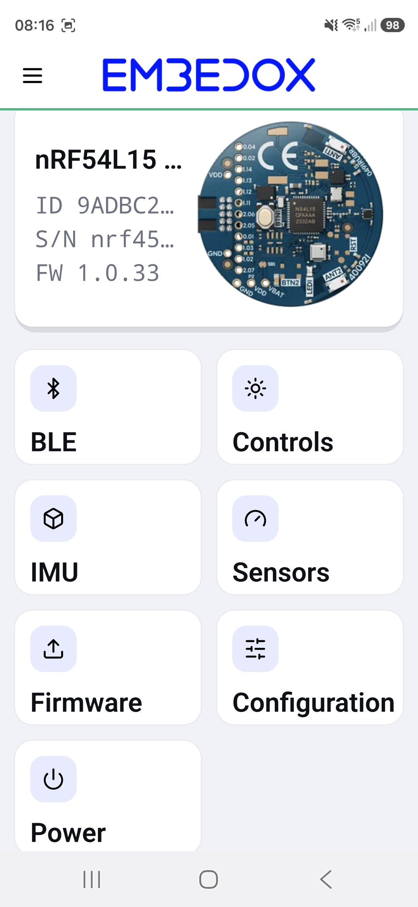 &nbsp; 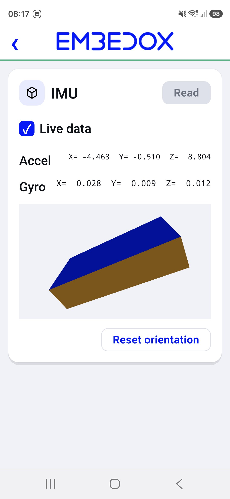 &nbsp; 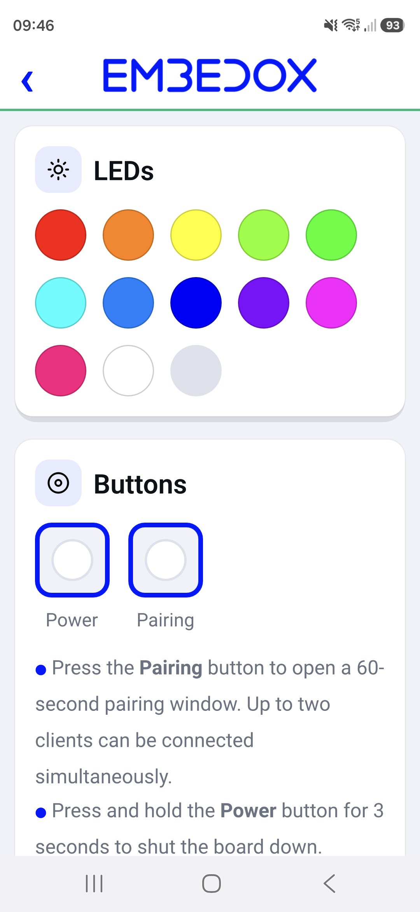

This repository hosts the toolkit's **firmware** (per board, under [Releases](https://github.com/embedox/embiot-toolkit/releases)) and the **documentation**; the application is on Google Play and the App Store. The application itself works fully offline — it never uses the internet, collects no data, and needs no account.

---

## 1. Install the peripheral firmware (First‑time)

Download the board's peripheral firmware from [Releases](https://github.com/embedox/embiot-toolkit/releases) and follow the **First‑time install** steps on its board page.

| Board | SoC | Typical capabilities |
|---|---|---|
| [**nRF5340 DK**](docs/boards/nrf5340dk.md) | nRF5340 | BLE · Controls · Power · Camera · Firmware · Configuration |
| [**nRF5340 Audio DK**](docs/boards/nrf5340audiodk.md) | nRF5340 | BLE · Controls · Power · Firmware · Configuration |
| [**nRF54L15 DK**](docs/boards/nrf54l15dk.md) | nRF54L15 | BLE · Controls · Power · Camera · Firmware · Configuration |
| [**nRF54L15 tag**](docs/boards/nrf54l15tag.md) | nRF54L15 | BLE · Controls · Power · IMU · Sensors · Firmware · Configuration |
| [**Thingy:53**](docs/boards/thingy53.md) | nRF5340 | BLE · Controls · Power · IMU · Sensors · Firmware · Configuration |
| [**ESP32‑S3‑DevKitC**](docs/boards/esp32s3.md) | ESP32‑S3 | BLE · Controls · Power · Firmware · Configuration |

> **Camera** — boards marked Camera drive an [Arducam Mega SPI camera](docs/camera.md). The camera‑enabled firmware is not part of the standard release; request it from support@embedox.com.

Once EMBEDOX peripheral firmware is running, future updates (FOTA) can be done from the EMBIoT Toolkit application, which carries the current peripheral firmware for every supported board.

---

## 2. Peripheral firmware behavior

The board runs a state machine; the LED shows which state it is in.

| State | LED | What happens |
|---|---|---|
| Idle | 🟢 green, slow blink | No client device is connected. Client devices already paired may connect. After 5 minutes without a connection the board shuts down. |
| BLE pairing | 🔵 blue, fast blink | A pairing window is open: the board advertises as `EMBEDOX.<serial>` and any client device may pair. The window closes as soon as a client connects; if none does within 60 seconds the board returns to idle, or to connected (if a client was already connected). |
| BLE connected | 🔵 blue, steady | One or more client devices are connected. No timeout; when the last client device disconnects the board returns to idle. |
| Error | 🔴 red, steady | A failure was detected. The board shuts down after 45 seconds; wake it to try again. |
| Shut down | ⚫ off | The board shuts down after the idle timeout or after holding the power button for 3 seconds. To wake the board, press its wake button once. |

---

## 3. The EMBIoT Toolkit application

### Capability‑driven pages

On connection the firmware reports its capabilities (LEDs and buttons, IMU, environment sensors, camera) and the application builds the Hub view from that report. A board with an IMU gets the IMU page, a board with a camera gets the Camera page, and a board without either shows neither. One application therefore serves every supported board.

### Connect

1. **Power the board.** Its LED blinks 🟢 green slowly, which means idle: the board accepts only client devices that have paired with it before. A client device that has never paired will not find it in a scan until the next step.
2. **Press the pairing button** (find its location on the board page). The LED blinks 🔵 blue quickly for 60 seconds: the board now advertises as `EMBEDOX.<serial>` and any client device may pair.
3. Open the **EMBIoT Toolkit** application → **BLE** → **Start Scan** → tap the board.
4. **Enter the pairing passkey when prompted:**

   > ### 🔑 BLE passkey: `000000`
   >
   > On first connection the client device shows a **Bluetooth pairing request** — type **`000000`**. The client device keeps the bond, so future connections pair automatically. The fixed passkey is an evaluation setting of the reference firmware, not a production security model. **Auto-connect** in the application side menu, on by default, reconnects to any saved board as soon as it is seen advertising.

5. **BLE paired and connected.** Once the passkey is accepted, the LED turns steady 🔵 blue and the application opens the **Hub** page.

The client device is now bonded to the board. Later connections need no button: the board accepts a known client. Press the pairing button again only to add another client device.

---

### Hub

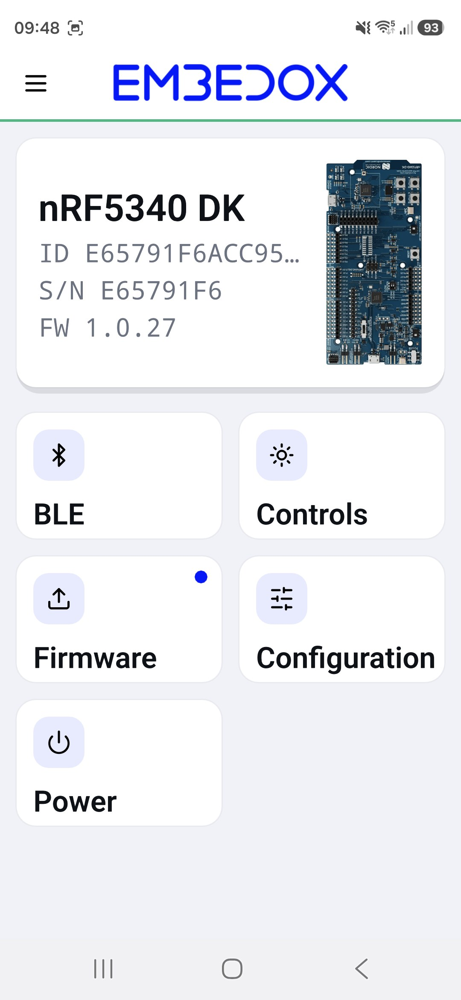

The Hub page identifies the connected board — it shows its name, picture, ID, serial, and firmware version — and holds one tile for each capability the board supports, as reported by the peripheral firmware on connection.

- **ID** is read from the SoC hardware and is read-only.
- **S/N** is stored on the board, editable on the Configuration page, and derived from the hardware ID by default.

 

---

### BLE

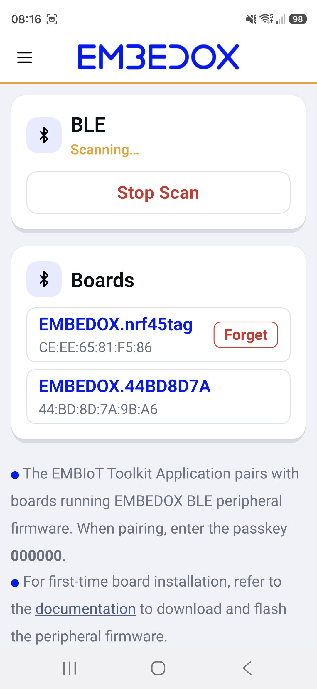

The BLE page manages boards and connections. It lists the boards currently in range and the boards saved from earlier connections.

 

---

### Controls

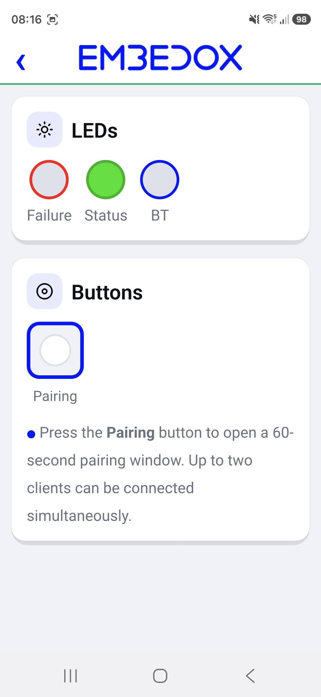

The Controls page sets the board's LED colors and shows its button presses live. A color set here replaces the state color and stays until the board's next state change rewrites it.

 

---

### Power

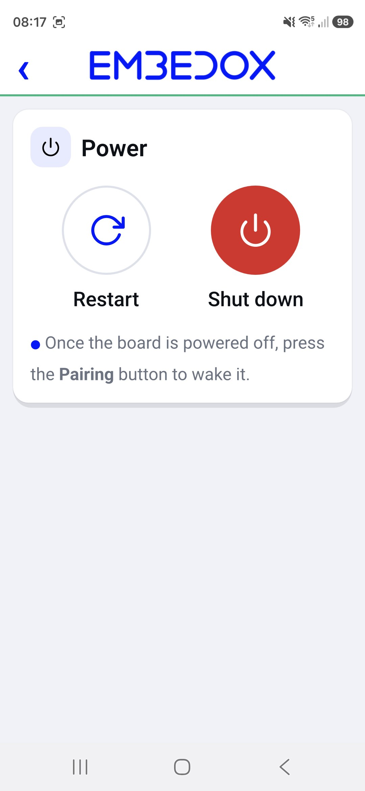

The Power page restarts or shuts down the board. **Shut down** powers the SoC off after arming the wake button.

 

---

### Sensors

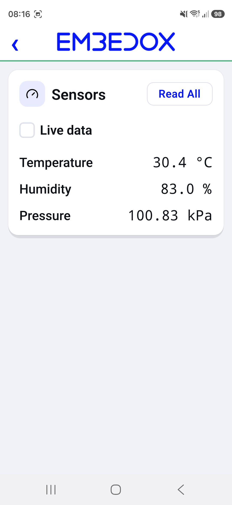

The Sensors page shows the board's environment readings live.

 

---

### IMU

The IMU page shows the board's orientation live. The 3D view is computed by the application from the gyroscope and the accelerometer.

 

---

### Camera

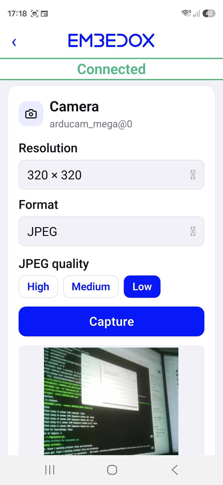

The Camera page captures a still image on the camera module fitted to the board and transfers it over Bluetooth LE. It needs the camera‑enabled peripheral firmware, available on request; the module and its wiring are on the [camera page](docs/camera.md).

 

---

### Firmware

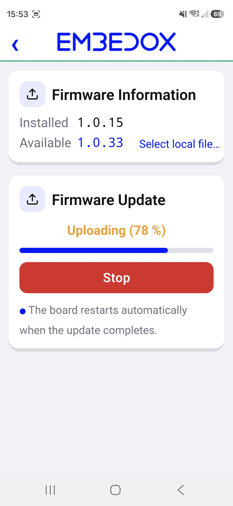
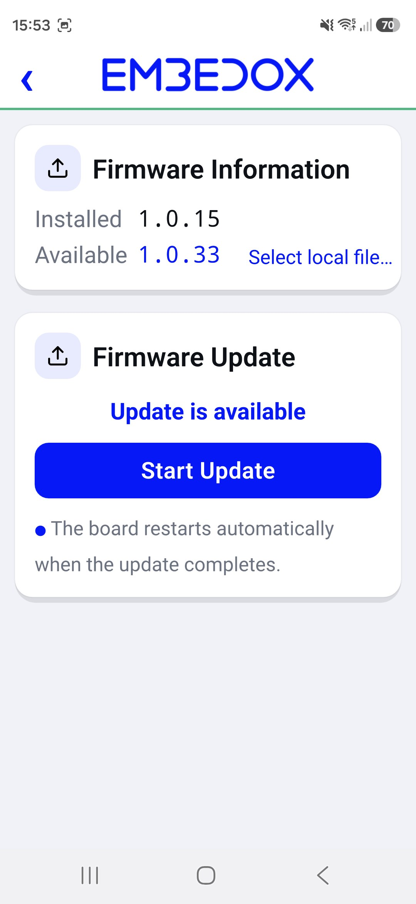

The Firmware page compares the firmware on the board with the image the application bundles for it and runs the FOTA update.

When the update completes, the application restarts the board, and the bootloader checks the signature of the new image and installs it. FOTA updates the board's application image only; on the nRF5340-based boards the network core is not updated over the air.

 

---

### Configuration

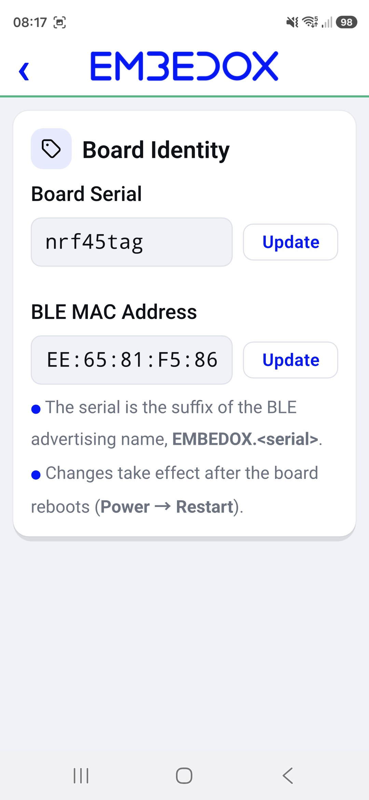

The Configuration page edits the values stored on the board.

- **Board Serial** — set the board's serial, the suffix of its advertising name `EMBEDOX.<serial>`.
- **BLE MAC Address** — replace the factory MAC address with your own.

Changes take effect at the next restart.

 

---

### Side menu

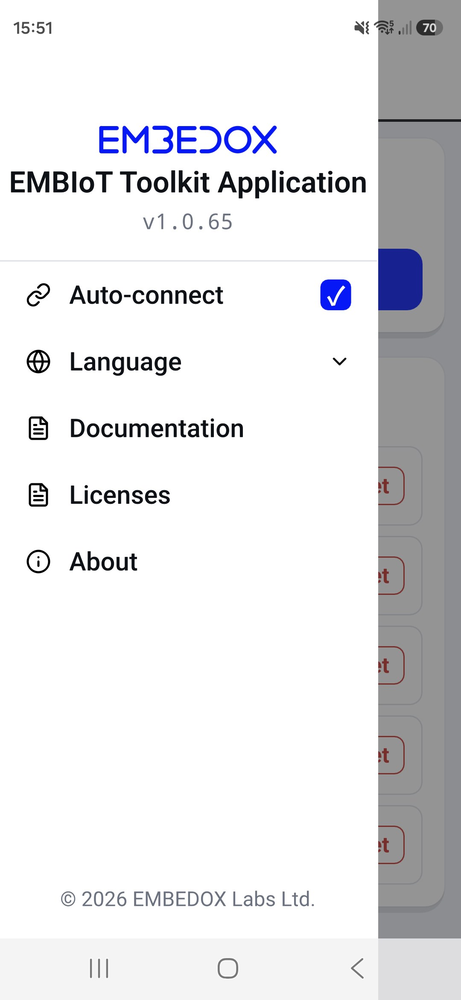

The side menu (☰), opened from the root page, holds the application's own settings: **Auto-connect**, **Language**, and the **Documentation**, **Licenses**, and **About** entries.

 

---

## Troubleshooting

- **Pairing fails / wrong passkey** — the passkey is **`000000`**. If it still fails, **Forget** the board in the application, remove it from the client device's Bluetooth settings, press the pairing button, then scan and pair again.
- **Board doesn't appear in the scan** — a client device the board does not know yet sees it only while the LED blinks blue: press the pairing button and scan within 60 seconds. Also confirm that the board is powered and running EMBEDOX firmware, that Bluetooth is enabled on the client device, and that the client device supports Bluetooth 5 extended advertising, which the board uses.

---

## About EMBEDOX

[**EMBEDOX**](https://www.embedox.com) designs and ships embedded products end to end — silicon bring‑up, Zephyr and embedded Linux, Bluetooth LE and wireless connectivity, device drivers, secure firmware and FOTA, and the cross‑platform applications that go with them. EMBIoT Toolkit is a working sample of that capability.

Building something like this? → **[embedox.com](https://www.embedox.com)**

---

## Links & support

- **Website:** [embedox.com](https://www.embedox.com)
- **EMBIoT Toolkit application privacy policy:** [embedox.com/embiot-privacy](https://www.embedox.com/embiot-privacy)
- **Support:** support@embedox.com
- **License:** [LICENSE.md](LICENSE.md) · third-party components: [THIRD_PARTY_NOTICES.md](THIRD_PARTY_NOTICES.md)

---

EMBIoT Toolkit is provided by EMBEDOX Labs Ltd for evaluation and demonstration on supported MCU development boards. © 2026 EMBEDOX Labs Ltd. All rights reserved. Nordic, nRF, and Thingy are trademarks of Nordic Semiconductor ASA.
