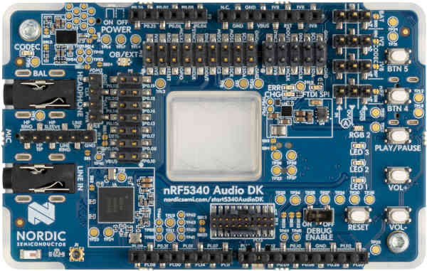

<div align="center">


# nRF5340 Audio DK

[Overview](../../README.md) &nbsp;·&nbsp; [Download board firmware](https://github.com/embedox/embiot-toolkit/releases)

</div>

---

Nordic **nRF5340 Audio DK**, the nRF5340 development kit for LE Audio.

| | |
|---|---|
|  | **SoC** nRF5340, application and network core<br>**Debugger** on‑board SEGGER J‑Link (debug USB port)<br>**Pairing button** VOL+ (push button 2)<br>**Power button** VOL− (push button 1), hold 3 s<br>**Wake button** VOL−<br>**First‑time install** J‑Link, two `.hex` files<br>**Release files** `peripheral-nrf5340audiodk-<ver>.hex` · `peripheral-nrf5340audiodk-<ver>-net.hex` |

## Capabilities in EMBIoT Toolkit

| BLE | Controls | Power | IMU | Sensors | Camera | Firmware | Configuration |
|:---:|:---:|:---:|:---:|:---:|:---:|:---:|:---:|
| ✓ | ✓ | ✓ | — | — | — | ✓ | ✓ |

## First‑time install

1. Download `peripheral-nrf5340audiodk-<ver>.hex` and `peripheral-nrf5340audiodk-<ver>-net.hex` from [Releases](https://github.com/embedox/embiot-toolkit/releases).
2. Connect the DK's debug USB port (the on‑board J‑Link).
3. **nRF Connect for Desktop → Programmer:** **Add file** both `.hex` files → **Erase all & write**. The Programmer places each file on its core by address.

   Or from the command line:

   ```bash
   nrfutil device program --firmware peripheral-nrf5340audiodk-<ver>-net.hex --core network --options chip_erase_mode=ERASE_ALL
   nrfutil device program --firmware peripheral-nrf5340audiodk-<ver>.hex --core application --options chip_erase_mode=ERASE_ALL,reset=RESET_SYSTEM
   ```
4. Done when the LED blinks green slowly. Continue with **Connect** in the [README](../../README.md#connect): press the pairing button and pair the client device.

## Release files

| File | Contains | Goes in with |
|---|---|---|
| `peripheral-nrf5340audiodk-<ver>.hex` | MCUboot + application image | application core, J‑Link |
| `peripheral-nrf5340audiodk-<ver>-net.hex` | network core image (ipc_radio) | network core, J‑Link |

All files are under [Releases](https://github.com/embedox/embiot-toolkit/releases) with a `SHA256SUMS.txt`.

## Board notes

- The status LED is **RGB1**; RGB2 and the three single LEDs are not used. The kit's audio codec, microphones and LE Audio features are not used by the peripheral firmware.
