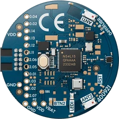

<div align="center">


# nRF54L15 tag

[Overview](../../README.md) &nbsp;·&nbsp; [Download board firmware](https://github.com/embedox/embiot-toolkit/releases)

</div>

---

A compact **nRF54L15** tag‑format board with an IMU and an environment sensor.

| | |
|---|---|
|  | **SoC** nRF54L15<br>**Debugger** none on board; external SEGGER J‑Link on the SWD header<br>**Pairing button** push button on top<br>**Power button** none; use **Power → Shut down** in the application<br>**Wake button** push button on top<br>**First‑time install** external J‑Link, one `.hex` file<br>**Release files** `peripheral-nrf54l15tag-<ver>.hex` |

## Capabilities in EMBIoT Toolkit

| BLE | Controls | Power | IMU | Sensors | Camera | Firmware | Configuration |
|:---:|:---:|:---:|:---:|:---:|:---:|:---:|:---:|
| ✓ | ✓ | ✓ | ✓ | ✓ | — | ✓ | ✓ |

## First‑time install

1. Download `peripheral-nrf54l15tag-<ver>.hex` from [Releases](https://github.com/embedox/embiot-toolkit/releases).
2. Attach an external SEGGER J‑Link to the SWD header and power the tag.
3. **nRF Connect for Desktop → Programmer:** select the J‑Link → **Add file** `peripheral-nrf54l15tag-<ver>.hex` → **Erase all & write**.

   Or from the command line:

   ```bash
   nrfutil device program --firmware peripheral-nrf54l15tag-<ver>.hex --options chip_erase_mode=ERASE_ALL,reset=RESET_SYSTEM
   ```
4. Done when the LED blinks green slowly. Continue with **Connect** in the [README](../../README.md#connect): press the pairing button and pair the client device.

## Release files

| File | Contains | Goes in with |
|---|---|---|
| `peripheral-nrf54l15tag-<ver>.hex` | MCUboot + application image | J‑Link |

All files are under [Releases](https://github.com/embedox/embiot-toolkit/releases) with a `SHA256SUMS.txt`.
