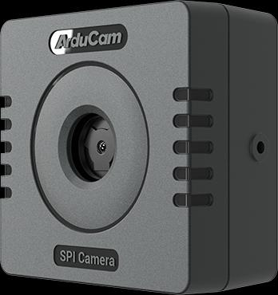

# Camera module

[Overview](../README.md) &nbsp;·&nbsp; [nRF5340 DK](boards/nrf5340dk.md)

---

The camera‑enabled peripheral firmware drives an **Arducam Mega 5MP SPI camera with autofocus lens** ([Arducam B0401](https://www.arducam.com/presale-mega-5mp-color-rolling-shutter-camera-module-with-autofocus-lens-for-any-microcontroller.html)) over four SPI wires and two power wires. No other host interface is needed.

| | |
|---|---|
|  | **Sensor** OmniVision OV5640, 1/4″, 2592 × 1944 (5 MP), rolling shutter, color **Lens** 3.3 mm, f/2.0, 68.75° diagonal, autofocus from 8 cm to infinity **Interface** SPI mode 0, 8 MHz, four wires (SCK, MISO, MOSI, CS) **Power** 3.3 V from the DK; 55 mA idle, 154 mA while capturing |

## Wiring to the nRF5340 DK

Follow the pin order printed on the module's connector, **VCC GND SCK MISO MOSI CS**.

| Camera pin | DK header pin | nRF5340 pin |
|---|---|---|
| VCC | **3V3** | — |
| GND | **GND** | — |
| SCK | **D13** | P1.15 |
| MISO | **D12** | P1.14 |
| MOSI | **D11** | P1.13 |
| CS | **D10** | P1.12 |

Power the module from the **3V3** pin, not from 5 V. The firmware clocks the bus at 8 MHz.

## Firmware

The camera‑enabled peripheral firmware is available on request from support@embedox.com; it is installed exactly like the standard image (see the board page) and, once the module answers on the bus, reports the camera to the application, which then shows the **Camera** tile on the Hub page.

Captured images are written to the DK's external flash before transfer. When the flash fills up, the oldest images are evicted.

## Using it

Capture, preview, image settings and saving are described under **Camera** in the [README](../README.md#camera).
